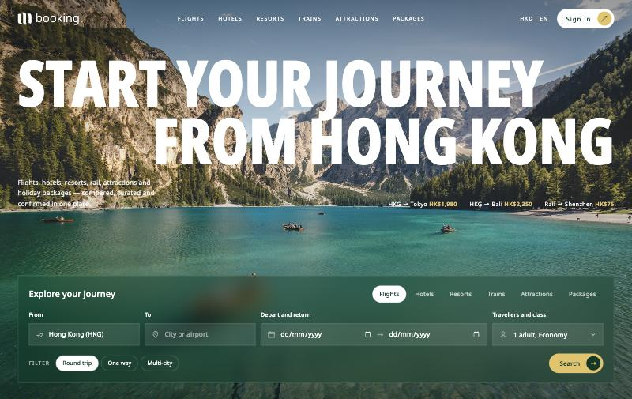
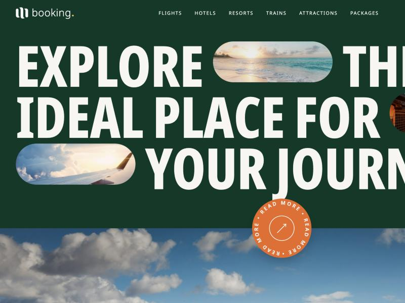

<div align="center">

# M Booking

**Travel, curated from Hong Kong.**

The customer-facing website for M Booking — the travel arm of [Mela](https://shop.mela.global/).
Flights, hotels, resorts, trains, attractions and holiday packages, in one booking.

[](https://mela-booking.vercel.app)




</div>

---

## What this is

This repository holds the **frontend only**. There is no backend, no build step and no
framework — just static files you can open in a browser.

A separate backend team owns the APIs. Everything here is built so that work can slot in:
forms are plain HTML with documented field names, and every piece of list content is marked
as a placeholder to be replaced by real data.

> [!IMPORTANT]
> All copy, photography, prices, ratings, stats and staff profiles are **placeholders**.
> See [Before launch](#before-launch) for the full list of what must be replaced.

## Quick start

No install, no dependencies, no build:

```bash
git clone https://github.com/alokdesaii/m-booking.git
cd m-booking
open index.html
```

To serve it over HTTP instead (useful for testing relative paths):

```bash
python3 -m http.server 8000
```

## What's in the box

| Path | What it is |
|---|---|
| `index.html` | The homepage. All styles and scripts are inline — one file, one request. |
| `index-v1.html` | The previous design, kept for reference. Not linked from the live site. |
| `brand/m-booking-logo.svg` | The logo lockup: the Mela **M** mark plus the word *booking*. |
| `docs/` | Screenshots used in this README. |

## The page, section by section

| # | Section | What it does |
|---|---|---|
| 1 | **Hero** | Full-screen photo, headline, live deal prices, and the search panel. |
| 2 | **Most viewed** | Four stay cards with photo, rating, price and a save-to-favourites heart. |
| 3 | **Explore band** | Deep-green band with photos set into the headline, then a full-width photo with a spinning badge and key stats. |
| 4 | **Discover** | An editorial feature on one destination, with a second badge. |
| 5 | **Brand film** | Full-width photo with a play button, ready for a video. |
| 6 | **Top destinations** | Six country rows. Hovering one turns it orange and shows a photo that follows the cursor. |
| 7 | **Journal** | Three travel articles, one large and two small. |
| 8 | **Concierges** | Three fanned cards for the Hong Kong travel team. |
| 9 | **Contact** | Name and email enquiry form. |
| 10 | **Footer** | Newsletter signup, link columns and a back-to-top control. |

## The search panel

The centrepiece. Six categories, each with its own fields and its own filter chips, all
inside a frosted-glass panel sitting on the hero photo. Visible without scrolling on load,
because search is what people come to a booking site to do.



### Form contract

Each category is a separate `<form method="get">`. Submitting navigates to the action with
the fields as query parameters. To wire these up, either change the `action` or intercept
the `submit` event and call your API.

| Category | Action | Fields |
|---|---|---|
| Flights | `/search/flights` | `trip` · `from` · `to` · `depart` · `return` · `pax` |
| Hotels | `/search/hotels` | `type` · `q` · `checkin` · `checkout` · `guests` |
| Resorts | `/search/resorts` | `style` · `q` · `checkin` · `checkout` · `guests` |
| Trains | `/search/trains` | `trip` · `from` · `to` · `date` · `pax` |
| Attractions | `/search/attractions` | `kind` · `q` · `date` · `guests` |
| Packages | `/search/packages` | `nights` · `from` · `to` · `month` · `pax` |

**Filter chip values** (the first is selected by default):

- `trip` — `round-trip` · `one-way` · `multi-city` (flights), `one-way` · `return` (trains)
- `type` — `hotels` · `boutique` · `apartments` · `villas` · `hostels`
- `style` — `any` · `beach` · `mountain` · `wellness` · `all-inclusive`
- `kind` — `all` · `tours` · `theme-parks` · `museums` · `shows` · `day-trips`
- `nights` — `3–5 nights` · `6–8 nights` · `9+ nights`

**Formats** — dates are `YYYY-MM-DD` from native date inputs; `month` is `YYYY-MM`.

> [!NOTE]
> `pax` and `guests` are currently plain dropdowns that submit their label text
> (for example `2 adults, 1 room`). They should become proper adult / child / room
> counters once the booking data shape is settled.

### Other forms

| Form | Action | Fields |
|---|---|---|
| Contact | `POST /contact` | `name` · `email` |
| Newsletter | `POST /newsletter` | `email` |

### Hooks with no backend yet

- **Favourite hearts** (`.fav`) toggle `aria-pressed` locally only — persist to the user's saved list.
- **Play button** (`.play`) has no video attached — wire to a modal when the film exists.
- **Most viewed cards, destination rows and journal posts** are static markup — render from the API.
- **Most viewed filter chips** are presentational — they don't filter anything yet.

## Design system

One set of rules, used everywhere. Changing a token changes the whole page.

### Colour

| | Hex | Used for |
|---|---|---|
|  | `#013927` | Primary green — headings, dark sections, footer |
|  | `#ec681f` | Orange accent — labels, prices, hover states |
|  | `#e6c260` | Gold — arrow circles, small highlights |
|  | `#2c904c` | Leaf green — positive states |
|  | `#262622` | Ink — body text |
|  | `#f8f6f1` | Cream — light backgrounds |
|  | `#b6b6b6` | Grey — borders, muted text |

### Type

- **Headings** — Noto Sans Display Condensed, 800 weight, uppercase, tight. One style, every section.
- **Body and labels** — Noto Sans. Labels are small uppercase with wide letter-spacing.
- The large size gap between the two is deliberate: it's what stops the page looking templated.

### Components

- **Pill button** — green capsule with a gold circled arrow that rotates on hover. Used for every call to action.
- **Spinning badge** — circular "READ MORE" badge with text on a path.
- **Thin rules** — hairlines separate rows instead of boxes, shadows or cards.

## Motion and performance

Booking sites live or die on load time, so there are **no animation libraries** — just CSS
and roughly ten lines of plain JavaScript.

| Effect | How it's done |
|---|---|
| Hero intro | CSS `@keyframes`, staggered by `animation-delay` |
| Scroll reveals | One shared `IntersectionObserver`, unobserved after firing |
| Sticky header | A single passive `scroll` listener toggling one class |
| Parallax | CSS `animation-timeline: view()`, with a still-image fallback |
| Hover states | Pure CSS, scoped to `@media (hover: hover)` so phones don't stick |

**Loading:** the hero image is preloaded with `fetchpriority="high"`; every image below the
fold is `loading="lazy"`. Connections to the font and image hosts are opened early with
`preconnect`.

**Accessibility:** all motion is disabled under `prefers-reduced-motion: reduce`. Form
fields are properly labelled, the tabs use `role="tab"` with `aria-selected`, and the
favourite buttons expose `aria-pressed`.

## Browser support

Modern evergreen browsers. Two features degrade gracefully rather than breaking:

- `backdrop-filter` (the frosted search panel) — falls back to a solid translucent green.
- `animation-timeline` (parallax) — falls back to a static background.

## Before launch

- [ ] **Photography** — every image is a hotlinked Unsplash placeholder. Replace with licensed assets, served from your own CDN. **When you do, re-check the white text on the hero, the "who we are" band and the brand film.** Each of those sections carries a gradient scrim tuned so text stays readable; a much brighter photo may need its scrim strengthened. There is a shared `text-shadow` as a second line of defence — see the *Legibility over photography* block in `index.html`.
- [ ] **Copy** — hero deal prices, the Kyoto feature, journal articles and concierge profiles are all invented.
- [ ] **Stats** — `06 ways to travel`, `24/7 concierge support` and `HK$0 booking fees` need confirming.
- [ ] **Licence number** — the footer has a blank Travel Agent Licence placeholder.
- [ ] **Links** — every `href="#"` needs a real destination (sign in, destinations, careers, terms, privacy).
- [ ] **Logo** — the wordmark in `brand/m-booking-logo.svg` is live Noto Sans text. Convert to outlines before sending to print vendors.
- [ ] **Counters** — replace the `pax` / `guests` dropdowns with real traveller pickers.

## Deployment

Deployed on Vercel as a static site. Pushes to `main` deploy automatically once the
repository is connected to the project.

```bash
vercel deploy --prod
```

---

<div align="center">
<sub>A Mela company · Hong Kong SAR</sub>
</div>
